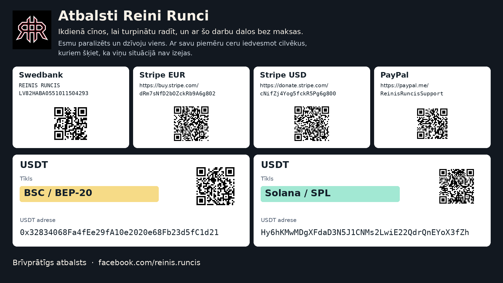

# REYRUN Recursive Deep Search

Publiskais autorētais izpētes izdevums ietver pilnās atbildes, aprēķinus un ziņotos rezultātus. Iekšējie izpildes ieraksti, neapstrādātie auditi un rīku vaicājumu izdrukas nav iekļautas. Skati [publikācijas tvērumu](PUBLICATION_SCOPE.md) un [publicētos rezultātus](PUBLISHED_FINDINGS.lv.md).

[English](README.md) · [简体中文](README.zh-CN.md)

Izpētes prasme, kas nākamajā meklējumā izmanto iepriekšējo pieredzi un pārbauda izmaiņas savā darba kārtībā. Tā palīdz atrisināt ikdienas un speciālistu jautājumus, pārbaudīt aprēķinus, atrast lietojamu programmatūru un izvērtēt pamatotas jaunu kombināciju idejas. Meklējumus veic tavs esošais MI aģents; pastāvīgai mācīšanai tā izpildvidei jāpieslēdz pievienotais darba cikls. Ar piekļuvi tīmeklim aģents ievēro angļu, vācu, ķīniešu un japāņu valodas meklēšanas kārtību un atbild tavā valodā. Citas izpētes valodas pievieno tikai pēc tavas norādes.

Prasme noder tehniskām izvēlēm, nepazīstamu darbības mehānismu izpētei, sarežģītiem savienojumiem un projektiem, kuru vajadzīgais kods paslēpies zem vecāka nosaukuma, mazā repozitorijā vai pētnieka vietnē.

## Video un materiāli, ar kuriem dalīties

[Video latviski](media/reyrun-rekursive-deep-search-demo-lv.mp4) · [Video angliski](media/reyrun-rekursive-deep-search-demo-en.mp4) · [Subtitri un ieraksta apraksts](media/README.md).

Abi video ilgst 65 sekundes un ir bez skaņas. Tie ir montēti skaidrojoši video ar īstu Duck.ai/Claude Haiku 5.5 atbildi. Parādīta izpētes norādījumu izmantošana vienā pārlūka čatā; video neapliecina automātisku prasmes instalēšanu vai pastāvīgu atmiņu.

[30 izpētes piemēri](validation/2026-11-09-beta3/30-examples.lv.md) · [Facebook teksts latviski](promo/Facebook_REYRUN_LV.md) · [Facebook teksts angliski](promo/Facebook_REYRUN_EN.md). [Publiskā lejupielādes lapa](https://reyrun-rekursive-deep-search.runcisreinis.chatgpt.site). [Izplatīšanas stāvoklis](promo/README.md).

## 30 izpētīti piemēri

[Pārskatītajā 10 + 10 + 10 atlasē](validation/2026-11-09-beta3/30-examples.lv.md) ir 10 ikdienas jautājumi, 10 vidēji sarežģīti jautājumi dažādās nozarēs un 10 sarežģīti jautājumi. Septiņiem ir pilns augstākās matemātikas pierādījums vai atvasinājums un izpildīts aprēķins. Atlasē saglabāti 12 iepriekšējie piemēri un pievienoti 18 jauni; kopā tajā ir 156 vaicājumi. Katrā piemērā meklēts EN/DE/ZH/JA. Vaicājuma valoda vēl nenozīmē šajā valodā izlasītu atbalstošu avotu.

Sākotnējie 30 piemēri paliek [vēsturiskajā izdevumā](validation/2026-11-09/30-examples.lv.md); kopā ar papildinājumu ir 48 atšķirīgi pamatuzdevumi. Jautājumi sagatavoti pārbaudei, simulētie precizējumi marķēti. Avoti, apgalvojumi, izmantotās mācības un kontrolsummas ir pierādījumu reģistrā. Pilnie svešo lapu teksti publiskajā izdevumā nav pārpublicēti.

Šeit minētie iekšējie ieraksti šajā izdevumā nav publicēti; skati [publikācijas tvērumu](PUBLICATION_SCOPE.md).

82 programmas testu kvīts attiecas uz pārbaudīto kodu. Izlabotas divas atkārtojamas kļūmes: veca kartīte vairs nepaslēpj jaunāku neveiksmes novērojumu, un atmiņu var atgūt arī pie tās apjoma robežas. Tie ir programmas mehānisma testi, atsevišķi no faktiskās izpētes.

Šeit minētie iekšējie ieraksti šajā izdevumā nav publicēti; skati [publikācijas tvērumu](PUBLICATION_SCOPE.md).

Trīs jaunu uzdevumu salīdzinājumā abi paņēmieni izpildīja visus iepriekš fiksētos atbilžu kritērijus. Kandidāts izmantoja 43 tīmekļa darbības pret esošās metodes 47, bet nesasniedza prasīto precizitātes pieaugumu; tas netika ieviests kā jaunā pamatmetode. Salīdzinājuma nosacījumi, faktiskie rezultāti, robežas un četru neatkarīgu pārskatu secinājumi aprakstīti [laidiena ziņojumā](validation/2026-11-09-beta3/release-report.lv.md). Tas ir trīs uzdevumu pilots, ne universāla pārākuma pierādījums.

Šīs atlases sākuma un beigu ciklu vadīja čats; 14 jaunajām nozares un matemātikas atbildēm atsevišķi izpildīta stingrā ierakstu pārbaude. Iepriekšējā divu uzdevumu demonstrācija parāda īstu darbu caur stingro savienotāju un otrā uzdevuma ielādēto mācību. Neviens no šiem pierādījumiem pats par sevi neapliecina autonomu diennakts pakalpojumu.

Šeit minētie iekšējie ieraksti šajā izdevumā nav publicēti; skati [publikācijas tvērumu](PUBLICATION_SCOPE.md).

[Saglabātās kompaktās atziņas](references/observed-lessons.md) palīdz sākt nākamo izpēti ar pieredzi. Tām ir konkrēts tvērums; tās neaizstāj pieslēgtās izpildvides pašu atmiņu.

## Trīs ievada piemēri

Prasme pielāgo izpētes dziļumu un atbildes formu cilvēka jautājumam. Izlasi reāli izpētītos piemērus: [neskaidrs jautājums par kosmētiku](examples/cosmetics.md), [spēļu čītu darbības izpratne](examples/gaming.md) un [aģenta atmiņas arhitektūras izstrāde](examples/architecture.md). Avotu un vaicājumu reģistrs nošķir izlasīto, neizpildīto un piedāvāto. Tie ir izpētes piemēri, ne pierādījums, ka prasme vienmēr pārspēj citu metodi.

Šeit minētie iekšējie ieraksti šajā izdevumā nav publicēti; skati [publikācijas tvērumu](PUBLICATION_SCOPE.md).

## Pārbaudāmi fakti un saprotams jautājums

Prasmes obligātā kārtība sākas ar pašreizējiem ārējiem avotiem. Modeļa apmācības laikā iegūtās zināšanas palīdz saprast tēmu, bet neaizstāj pārbaudi. Katram pārbaudāmam apgalvojumam jāsaglabā saistība ar avotu; būtiskajiem apgalvojumiem ir atsauce arī pašā atbildē. Speciālistu sarunas, kļūdu apspriedes un faktiskās lietošanas pieredze palīdz atklāt, kas praksē strādā. Viedokli, izmērītu rezultātu un mūsu hipotēzi nosauc atšķirīgi.

Ja nav skaidrs, par kuru ierīci, vajadzību vai apstākļiem cilvēks runā, aģents vispirms uzdod īsu precizējošu jautājumu. Ja uzdevums ir saprotams un vēl nav zināma atbilde, aģents pats meklē pierādījumus. Jaunums jāpārbauda pēc attiecīgā apgalvojuma: jaunākā reklāma nevar atcelt spēkā esošu matemātisku rezultātu.

Katra būtiskā atbilde iziet pievienotās Humanizer procedūras redakciju un pilnu nozīmes, faktu un atsauču pārbaudi. Mērķis ir draudzīga, pieklājīga un zinātniski precīza valoda, kuras saprašanai nav jābūt nozares speciālistam. Izlasi [obligātos pierādījumu noteikumus](references/evidence-first-contract.md) un [rakstīšanas kārtību](references/writing-contract.md).

### Ja tavs mākslīgais intelekts izlaiž obligātos soļus

Iedod tam šo norādi:

> Pārlasi REYRUN REKURSIVE DEEP SEARCH obligātos pierādījumu un rakstīšanas noteikumus. Nosauc konkrēti izlaisto soli. Precizē neskaidro uzdevumu, pārbaudi nepamatotos apgalvojumus aktuālajos avotos un izlabo skartās rindkopas. Parādi īsu pamatojumu ar avotiem un pasaki, kas palicis nepārbaudīts. Pārbaudi arī, vai šā darba mācība tiešām saglabāta un nākamais uzdevums to ielādē.

Izpildvidē prasību pastiprina konkrēta beigu pārbaude: savienotājs pēc noklusējuma nepieņem darbu bez prasītajiem meklējumu, avotu, apgalvojumu, redakcijas un mācīšanās ierakstiem. Ierakstu pārbaude pati nenosaka, vai teikums ir patiess; to joprojām vērtē pēc izlasītā avota. Pārlūkprogramma, pastāvīga atmiņa un aģenta izpildes iespējas ir vajadzīgas attiecīgajam darbības režīmam. Spēcīgāks uzvednes formulējums šīs iespējas nepievieno.

## Maza pieredzes bibliotēka

Katras saglabātās metodes kartītes robeža ir 1500 rakstzīmes, ieskaitot tās laukus un izcelsmes norādes. Tajā ir situācija, paņēmiens, iznākums, nākamais pārbaudāmais solis un pierādījums. Vienādi ieraksti vienā tvērumā apvienojas; atšķirīgas neveiksmes nepazūd tikai līdzīgu vārdu dēļ. Darba atmiņas stāvoklim un tajā saglabātajiem pierādījumiem kopā ir 5 MiB robeža. Ārējo darbu žurnāliem un lejupielādēm vajadzīgi savi apjoma ierobežojumi.

Katra darba beigās obligāts ir pamatots mācīšanās lēmums. Uzlabojuma izpētei aģents izmanto šo pašu četru valodu kārtību. Plāns un faktiski izpildīta izpēte tiek pierakstīti atsevišķi. Ja mācīšanās lauki izlaisti, konfigurēts izpildītājs var saņemt vienu labošanas mēģinājumu sākotnējā termiņā; nepabeigtu mācīšanos nepieņem par pabeigtu. Pilnā automātiskā kandidātu veidošana un neatkarīgā vērtēšana vēl jāvada pieslēgtajai izpildvidei.

[Atmiņas un mācīšanās apraksts](references/compact-memory-contract.md) paskaidro arī sablīvēšanu. Tā apzināti var izņemt pilnus vecos pierādījumus, saglabājot kartītes un to kontrolsummas; tas nav bezzudumu arhīvs.

## Sāc ar vienu uzdevumu

Iedod aģentam repozitorija saiti vai visu lejupielādēto direktoriju un šo uzvedni:

> Izlasi šo repozitoriju un SKILL.md. Ja tava vide atbalsta prasmes, instalē un aktivizē REYRUN REKURSIVE DEEP SEARCH. Pievieno tās pastāvīgās atmiņas sākuma un beigu ciklu esošajai aģenta izpildvidei un pārbaudi, vai otrais uzdevums ielādē pirmā pieredzi. Ja jau ir kopīga atmiņa, izmanto to. Ja vide to neļauj, pasaki, kuras daļas patiešām aktivizēji, un šim uzdevumam izmanto izpētes kārtību. Izpēti [tēma] angļu, vācu, ķīniešu un japāņu valodā. Salīdzini gatavus risinājumus un piedāvā sintēzi tikai ar pamatotu priekšrocību.

Aizstāj `[tēma]` ar savu mērķi. Norādi ievadi, vēlamo rezultātu, pieejamo datoru, budžetu un būtiskos nosacījumus. Piemērs: “Uzlabot aģenta Markdown prasmi, nemainot modeļa svarus un izmantojot esošo izpildvidi.”

Instalēšanas vietu nosaka izmantotā vide. Kopē visu direktoriju ar atsauču failiem vietā, kuru tava vide dokumentē kā atbalstītu. Prasmes identifikators ir `reyrun-rekursive-deep-search`.

Ja vide prasmes neinstalē, aģents var ievērot [SKILL.md](SKILL.md) šajā uzdevumā. Repozitorija saites izlasīšana vēl neapliecina instalāciju, pastāvīgu atmiņu vai pieslēgtu izpildes ciklu. Aģentam jāpasaka, kuru režīmu tas pārbaudīja:

| Režīms | Kas darbojas |
|---|---|
| Izpētes kārtība | Aģents ievēro norādījumus pašreizējā uzdevumā. |
| Pastāvīgs rekursīvās attīstības cikls | Izpildvide sāk un noslēdz katru uzdevumu, saglabā pierādījumus un nākamajā uzdevumā ielādē pieredzi. |
| Pārbaudīta jaunā redakcija | Konkrēta darba kārtības izmaiņa izturējusi dokumentētu salīdzinājumu uz iepriekš noteiktiem uzdevumiem un pieņemta lietošanai. |

## Kas mainās starp meklējumiem

Uzdevuma sākumā programma iedod aģentam aktīvo darba kārtības versiju, pieņemtos paņēmienus un agrākus novērojumus no tās pašas uzdevumu grupas vai kopīgās grupas. Aģents pieraksta, ko no tā izmantoja un kāpēc pārējais neattiecās uz šo uzdevumu. Novērojumiem saglabājas nepārbaudītas pieredzes statuss, kamēr pierādījumi nepamato stingrāku secinājumu.

Pēc darba programma saglabā rezultātu, pierādījumu atsauces, izmaksas, kļūmes un noderīgos atradumus. Aģents var ierosināt meklēšanas paņēmiena maiņu. Piemēram, pārbaudīt repozitorija pašreizējos failus, ja vecs meklētāja fragments apgalvo, ka kods vēl nav pieejams. Jauno paņēmienu salīdzina ar aktīvo versiju vienādā budžetā. Pārbaudes nosacījumus un pareizās atbildes fiksē pirms izmēģinājumiem; pierādījumus izskata četras vērtēšanas perspektīvas.

Nākamajam uzdevumam par aktīvo versiju kļūst tikai pieņemta izmaiņa. Noraidītam kandidātam saglabā neveiksmes pierādījumus. Atgriežoties pie agrākas versijas, vēsture nepazūd. Nākamās izpildes sākuma ieraksts nosauc tieši ielādēto versiju.

Aģentam jāizskata katrs pabeigtais uzdevums, lai atrastu noderīgu mācību. Nevar garantēt, ka katrs meklējums būs precīzāks par iepriekšējo: uzdevumi atšķiras, avoti mainās, un iecerētais uzlabojums var neizdoties. Ja uzdevums nedod pamatotu jaunu mācību, to pieraksta, neizdomājot progresu.

## Kādu rezultātu saņemsi

| Rezultātu grupa | Saturs |
|---|---|
| Gatavi risinājumi | Vairāki atbilstoši varianti ar priekšrocībām, trūkumiem, licencēm, vajadzīgajiem resursiem un gatavības pierādījumiem. |
| Nepabeigti projekti un sintēze | Konkrētas pārņemamas komponentes, trūkstošais darbs un kombinācijas priekšlikums tikai tad, ja tā iespējamo priekšrocību pār gatavu risinājumu var pamatot. |

Katram ieteikumam nodala izlasītu avotu, pārskatītu kodu un reāli palaistu risinājumu. Sintēzes priekšlikumā nosauc salīdzinājuma variantu, iecerēto ieguvumu, mazu atspēkošanas testu un aplēses par darbu, kalendāro laiku, skaitļošanu, enerģiju, izmaksām un uzturēšanu ar pieņēmumiem. Ja pierādījumi nepamato izstrādi, rezultātā to pasaka.

Atbildē ir atlasītie atradumi, izvēles pamatojums un nākamā darbība. Meklējumu žurnāls un mācību vēsture paliek fonā, kamēr tos nepieprasi. Arī saprotamība ir vērtēšanas kritērijs: atbildei jāpalīdz pieņemt lēmumu, saglabājot vajadzīgos pierādījumus un nenoteiktību. Īsāka atbilde pati par sevi nav labāka.

## Kā notiek meklēšana

Aģents pielāgo terminus katrai valodai un seko vajadzīgajai funkcijai, kļūmei vai mehānismam. Tas pārbauda pirmavotus, projektu failus, atvasinātus repozitorijus (fork), kļūdu apspriedes, autoru vietnes, iestāžu arhīvus un lejupielādējamos pielikumus. Sinonīms, plašāks jēdziens un citas nozares analoģija terminu kartē paliek atšķirīgi ieraksti.

Darbu pārskata četras perspektīvas: optimistiskā, skeptiskā, konservatīvā un inovatīvā. Ja vide to atbalsta, atsevišķi aģenti sāk neatkarīgi. Citādi rezultātā norāda, ka viens aģents veicis četru perspektīvu pārskatu. Vaicājumu skaits un vērtētāju vienprātība neapliecina pareizību. Jaunas redakcijas pieņemšanai vajadzīgi neatkarīgas pārbaudes ieraksti; viena aģenta četru perspektīvu pārskats šo prasību neizpilda.

## Izpilde un pierādījumi

[Izpildes aprakstā](references/runtime-contract.md) ir komandas un ierakstu formāti. [Attīstības noteikumi](references/evolution-contract.md) skaidro, ko drīkst mainīt un kādi pierādījumi vajadzīgi.

Izpildāmais [aģenta savienotājs](references/host-contract.md) pats veic sākuma un beigu darbības ap konfigurēta izpildītāja darbu. Tas nodod saglabāto ievadi, nosaka termiņu un noraida rezultātu bez atbilstošas sākuma kvīts. Tas nodrošina šo kārtību darbiem, kas palaisti caur savienotāju. Automātiskai kandidātu veidošanai un neatkarīgo pārbaužu vadīšanai vēl jābūt pieslēgtam kontrolierim; prasmes instalēšana pati nepalaiž pastāvīgu pašpilnveides pakalpojumu.

```sh
python scripts/search_host.py --help
python scripts/recursive_search.py --help
python scripts/research_gate.py --help
```

`recursive_search.py` glabā uzdevumu ierakstus un darba kārtības versijas, sagatavo nākamā uzdevuma ievadi un pārbauda dokumentētos pārbaudes uzdevumus pirms jaunās versijas pieņemšanas. Tajā nav modeļa izsaucēja, tīmekļa meklētāja vai fona darbu plānotāja. Izpildvidei programma jāizsauc, jāveic pati izpēte un jānodala vērtētāja faili no kandidāta rakstīšanas tiesībām. Programmas ieraksti vieni paši nepierāda, ka izpildvide šo nodalījumu īsteno.

`research_gate.py` pārbauda izpētes ierakstu struktūru un deklarētos nosacījumus. Neviena no šīm programmām sekmīgu pārbaudi nepasniedz kā vispārējas kvalitātes pierādījumu. Rezultātos paliek `improvement_proven: false`; secinājumam par uzlabojumu jānosauc reālie izmēģinājumi, rezultāti un to robežas. Tur, kur pārbaudēs izmantoti sintētiski dati, tie apliecina programmas darbību, ne izpētes kvalitāti.

Prasmes instalēšana neapmāca modeļa svarus. Attīstība notiek, izmantojot saglabātu pieredzi, pārskatītus norādījumus un pārbaudītas darba kārtības izmaiņas. Ilgstošai patstāvīgai darbībai vajadzīgs reāls izpildītājs vai plānotājs, termiņš un resursu limiti. Modeļa un meklēšanas pakalpojumu izmaksas nosaka tava vide.

Avotu pārbaudes piemēram izlasi [īsto izpētes rezultātu](examples/real-result.md), kurā saglabātas publiskās projektu un avotu saites. Sākotnējais avotu reģistrs un vaicājumu izdruka šajā izdevumā nav iekļauti. Šajā piemērā neviens ārējais kandidātprojekts nav palaists.

## Izpētes ziņojums un pastāvīgā darba kārtība

[Izpētes un eksperimentu ziņojumā](EXPERIMENTS.lv.md) ir visas 30 gala atlases atbildes, visas 30 vēsturiskās atbildes, sešas stratēģiju salīdzinājuma atbildes, aprēķinu saites un autorētie laidiena secinājumi. Pilnās atbildes ir pieejamas angliski un latviski. Kandidāta noraidījums, kļūmes un robežas paliek aprakstītas. Pilnas vērtētāju izvades, izpildes ieraksti, vaicājumu izdrukas un iekšējās kvītis nav iekļautas; šo robežu paskaidro [publikācijas tvērums](PUBLICATION_SCOPE.md).

Lai lietotājam mācību saglabāšana nav jāatgādina, pēc uzstādīšanas šo kārtību nosaka par noklusēto attiecīgajiem izpētes uzdevumiem un pieslēdz [izpildāmo savienotāju](references/host-contract.md). Tas sākumā ielādē mācības un nepieņem darba noslēgumu bez derīga mācību ieraksta. Nepieciešama saglabāta atmiņas direktorija un pieslēgts pētniecības izpildītājs. Pēc pieslēgšanas jāveic divi secīgi darbi un jāpārbauda, vai otrajā ielādēta pirmā pieredze. Viena norādījumu faila nolasīšana pati par sevi šo pieslēgumu neizveido.

## Atbalsti autoru

Mani sauc Reinis Runcis. Esmu paralizēts un dzīvoju viens. Ikdienā cīnos, lai turpinātu radīt, un ar šo darbu dalos bez maksas. Ceru ar savu piemēru iedvesmot arī cilvēkus, kuriem šķiet, ka viņu situācijā nav izejas.

Ja šis projekts tev noder vai vēlies palīdzēt man turpināt iesākto, būšu pateicīgs par brīvprātīgu ziedojumu. Tavs atbalsts palīdz man ikdienā un darbā pie šādiem rīkiem.

Swedbank · Saņēmējs: **REINIS RUNCIS**  
IBAN: **`LV82HABA0551011504293`**

- [Stripe (EUR)](https://buy.stripe.com/dRm7sNfD2bOZckRb9A6g802)
- [Stripe (USD)](https://donate.stripe.com/cNifZj4Yog5fckR5Pg6g800)
- [PayPal](https://paypal.me/ReinisRuncisSupport)

**USDT · BSC / BEP-20**

`0x32834068Fa4fEe29fA10e2020e68Fb23d5fC1d21`

**USDT · Solana / SPL**

`Hy6hKMwMDgXFdaD3N5J1CNMs2LwiE22QdrQnEYoX3fZh`

[Vairāk par mani Facebook](https://www.facebook.com/reinis.runcis)

[Atbalsta lapa / Support page](SUPPORT.md)



## Licence

Oriģinālais teksts un kods pieejams ar [MIT licenci](LICENSE). `assets/support-card.png` ir autora apstiprināts atbalsta attēls, uz kuru MIT licence neattiecas. Atbalsta rekvizītus un logotipu drīkst attēlot kopā ar šo projektu; plašākas tiesības uz zīmolu vai personisko stāstu netiek piešķirtas. Arī oriģinālais REYRUN logotips ir izslēgts no MIT licences. Humanizer saglabā pievienoto MIT autortiesību norādi. Skatīt [NOTICE.md](NOTICE.md). Ārējiem projektiem saglabājas to licences.
