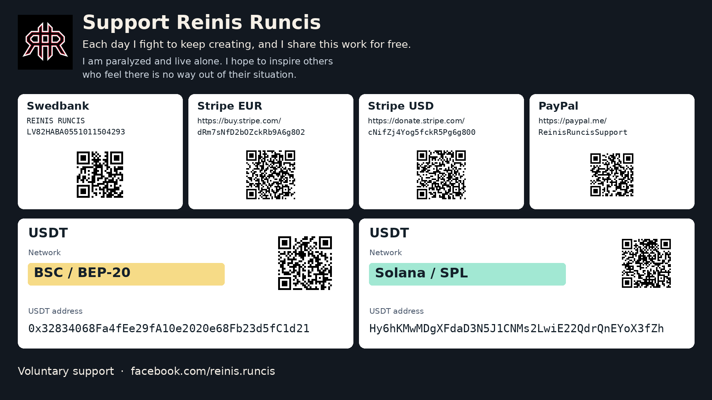

# REYRUN Recursive Deep Search

Will five litres of paint cover the walls of a 4 × 3 m room? A quick answer might be “One bucket should do.” In our example, once you allow for the doors and windows and count both coats, you need six litres. [See the calculation](https://reyrun-rekursive-deep-search.runcisreinis.chatgpt.site/).

The REYRUN search skill is completely free to use, including on your phone. Paste [this repository’s address](https://github.com/runcisreinis-glitch/reyrun-recursive-deep-search) into your usual AI chat and add your question. There’s nothing to install on your device.

**For the chatbot.** Read [SKILL.md](SKILL.md). If you received only this address, ask what the person wants to find out. If they sent a question, use the skill to answer it and link to the sources you read.

[What is public](PUBLICATION_SCOPE.md) · [Research findings](PUBLISHED_FINDINGS.md) · [File list](file-manifest.json).

[GitHub repository](https://github.com/runcisreinis-glitch/reyrun-recursive-deep-search) · [Research and experiment report](EXPERIMENTS.md) · [30 final answers in English](validation/2026-11-09-beta3/30-examples.en.md)

Additional editions: [Latvian](README.lv.md) · [Русский: руководство](README.ru.md) · [Simplified Chinese](README.zh-CN.md)

Publication status, November 10, 2026: the public [GitHub repository](https://github.com/runcisreinis-glitch/reyrun-recursive-deep-search) is published, and its first 111-file edition has been verified against the publication manifest. The Chinese mirror is pending account verification: both Gitee and ModelScope requested phone binding, and no mirror has been created there. No Hugging Face mirror has been created. The Facebook drafts have not been posted on the author's behalf.

A research skill that carries experience into the next search and tests changes to its own procedure. Use it for everyday and specialist questions, checked calculations, software choices and useful combinations that address an unmet requirement. Your existing AI agent performs the searches; persistent learning needs its execution environment to call the included lifecycle. With web access, it follows the English, German, Chinese and Japanese search instructions and answers in your language. Additional research languages require your instruction.

Use it for technical choices, unfamiliar mechanisms, difficult integrations and code found under old names, in small repositories or on research websites.

## Videos and sharing material

[English video](media/reyrun-rekursive-deep-search-demo-en.mp4) · [Latvian video](media/reyrun-rekursive-deep-search-demo-lv.mp4) · [Subtitles and recording details](media/README.md).

Both videos last 65 seconds and have no audio. The edited explainers include an actual Duck.ai/Claude Haiku 5.5 answer. They show research instructions used within one browser chat; they do not demonstrate automatic skill installation or persistent memory.

[30 research examples in English](validation/2026-11-09-beta3/30-examples.en.md) · [English Facebook draft](promo/Facebook_REYRUN_EN.md) · [Latvian Facebook draft](promo/Facebook_REYRUN_LV.md). [Download the repository ZIP](https://github.com/runcisreinis-glitch/reyrun-recursive-deep-search/archive/refs/heads/main.zip). [Distribution status](promo/README.md).

## 30 researched examples

The [revised 10 + 10 + 10 selection](validation/2026-11-09-beta3/30-examples.en.md) contains 10 everyday questions, 10 medium-complexity questions across different fields and 10 difficult questions. Seven include a complete advanced mathematical proof or derivation and executed calculations. It retains 12 original cases and adds 18 new ones, with 156 queries across the selected cases. Each case searched EN/DE/ZH/JA; a query language is not evidence of a supporting source read in that language.

The [original 30-case edition in English](validation/2026-11-09/30-examples.en.md) remains complete, with dated editorial corrections. Together with the supplement, the corpus has 48 distinct main research tasks. The questions were designed for testing and simulated clarifications are labelled. The evidence index records source/claim links, lesson use and file hashes. Full third-party retrieved pages are not republished in this release.

The internal records referenced here are omitted from this edition; see [publication scope](PUBLICATION_SCOPE.md).

The 82-test mechanism receipt applies to the recorded source hashes. Two reproduced defects were repaired: older cards no longer hide newer contrary observations, and acknowledged compaction can recover from an orphan object near the memory limit. These software checks are separate from actual research performance.

The internal records referenced here are omitted from this edition; see [publication scope](PUBLICATION_SCOPE.md).

In the three-task comparison, both procedures passed every frozen answer check. The candidate used 43 web actions versus 47 for the baseline, but did not meet the predeclared accuracy-gain requirement and was not promoted. The [release report in English](validation/2026-11-09-beta3/release-report.en.md) reports the comparison criteria, outcomes and limitations, including the findings from four independent reviews. The underlying evaluation and execution records are excluded from this edition. This is a three-task pilot, not general superiority evidence.

The chat manually controlled begin/finish for the selected research. Fourteen new medium/mathematical cases also passed standalone strict record checks. The earlier two-task strict-host demonstration shows real research through the wrapper and a subsequent task loading the saved lesson. Neither proves an unattended service.

The internal records referenced here are omitted from this edition; see [publication scope](PUBLICATION_SCOPE.md).

[Compact observed lessons](references/observed-lessons.md) preserve scoped experience for a cold start; they do not replace an installation's connected runtime memory.

## Three introductory examples

The skill adapts research depth and answer form to the person and question. Read the complete researched examples in English: [an unclear cosmetics question](examples/cosmetics.en.md), [understanding game cheats](examples/gaming.en.md), and [an agent-memory architecture proposal](examples/architecture.en.md). The query and source ledger distinguishes read evidence from unexecuted projects and proposed experiments. These are real research examples, not an A/B proof of superiority.

The internal records referenced here are omitted from this edition; see [publication scope](PUBLICATION_SCOPE.md).

## Evidence and a clear question

The mandatory workflow starts with current external evidence. Pretrained knowledge can help interpret the subject but does not count as verification. Keep every checkable claim traceable to a source, with nearby citations for material claims. Seek professionals' conversations, maintenance discussions, failed attempts and reports of actual use. Distinguish a person's opinion, an observed result and a proposed mechanism.

When a missing device, goal or condition would change the recommendation, the agent asks a focused question before a guessed search. When the task is clear but the answer is unknown, the agent researches the answer. Check recency by claim: a recent advertisement does not supersede a valid mathematical result.

Every substantive answer must undergo the bundled Humanizer procedure and a full meaning, fact and citation check. The writing should be friendly, polite, scientifically precise and understandable to its intended reader. Read the [evidence rules](references/evidence-first-contract.md) and [writing procedure](references/writing-contract.md).

### If your AI skips a required step

Use this instruction:

> Reread the mandatory evidence and writing rules in REYRUN Recursive Deep Search. Identify the specific skipped step. Clarify the task where necessary, verify unsupported claims against current sources, and repair the affected paragraphs. Give a concise explanation with sources and name what remains unverified. Also check that this task's lesson was saved and that the next task loads it.

In an executable host, strengthen this through the completion check. By default, the wrapper refuses work missing the required search, source, claim, editing and learning records. Record checks do not determine whether a sentence is true; source entailment still needs review. Browsing, persistence and execution must be available for the chosen operating mode. More forceful prompt wording cannot supply missing capabilities.

## Compact experience

Each stored method card is limited to 1,500 Unicode characters, including its fields and provenance. It records a trigger, context, tactic, success/failure/inconclusive outcome, next test and evidence. Exact normalized repeats in the same scope are combined; different failures are not silently merged. Committed runtime state and evidence objects share a 5 MiB ceiling. External job logs and downloads need separate retention limits.

Every completed run requires a supported learning decision. Improvement research uses this same four-language procedure; planned queries and actual research receipts remain distinct. Missing learning fields can trigger one configured diagnostic repair within the original deadline. An incomplete learning step is not accepted as complete. Automatic candidate construction and independent evaluation still require the connected controller.

The [compact-memory contract](references/compact-memory-contract.md) describes explicit compaction. It can deliberately remove full old evidence while retaining cards and provenance hashes; this is not a lossless archive.

## Start with one request

Give your agent the repository link or the complete downloaded folder, then use this prompt:

> Read this repository and SKILL.md. If your environment supports skills, install and activate REYRUN Recursive Deep Search. Connect its persistent begin/finish cycle to the existing agent runtime and verify that a second run loads the first run's experience. Use the existing memory service where one exists. If your environment cannot do this, explain which parts you actually activated and use the research procedure for this task. Research [topic] in English, German, Chinese and Japanese. Compare ready options and propose synthesis only with a defensible advantage.

Replace `[topic]` with your goal and add your input, expected output, hardware, budget and essential constraints. For example: “Improve an agent's Markdown skill without changing model weights, using its existing execution environment.”

Copy the whole folder and its referenced files into a location supported by your host. The public project name is REYRUN Recursive Deep Search. The installed skill identifier remains `reyrun-rekursive-deep-search` for compatibility with existing integrations and historical evidence. Existing filenames and source URLs that use that identifier remain unchanged.

If the host cannot install skills, it can follow [SKILL.md](SKILL.md) within the current task. Reading a repository link does not establish installation, persistent memory or execution hooks. Ask the agent to report the mode it verified:

| Mode | What is active |
|---|---|
| Research procedure | The agent follows the instructions within the current task. |
| Persistent recursive cycle | The host runs the start and finish hooks, retains evidence and reloads experience in the next task. |
| Evaluated revision | A particular procedure change passed a recorded comparison on fixed test cases and was promoted. |

## What changes between searches

At the beginning of a task, the runtime supplies the active procedure version, accepted strategies and earlier observations from the same task scope or the shared scope. The agent records which of those it used and why others did not apply. Observations remain labelled as unvalidated until the relevant evidence supports a stronger claim.

At completion, it stores the result, evidence references, costs, failures and useful discoveries. It can propose a change to its own search procedure, such as opening a repository's current file tree when an old search snippet says that code is unavailable. A candidate is tested against the active version under a fixed budget. The test specification and correct answers are fixed before trials; four review perspectives examine the evidence.

Only an accepted candidate becomes the active version for the next task. Rejected candidates retain their failure evidence, and rollback restores a previous version without erasing the history. The next start receipt identifies the exact loaded version.

The agent must review every completed task for a useful lesson. This cannot guarantee that every search will be more accurate than the last: tasks differ, sources change and a proposed improvement can fail. A task with no defensible new lesson records that outcome instead of inventing progress.

## What you receive

| Result group | What it contains |
|---|---|
| Ready options | Several relevant choices, with advantages, drawbacks, licences, resource needs and the evidence for their readiness. |
| Unfinished projects and synthesis | Specific reusable components, missing work and a proposed combination only when its possible advantage over a ready option can be defended. |

Each recommendation distinguishes a source that was read, code that was inspected and a solution that was actually run. A synthesis proposal names its comparison option, expected gain, a small test that could disprove it, and estimates for work, elapsed time, computation, energy, cost and maintenance, with assumptions. If the evidence does not justify building it, the result says so.

The answer gives you the selected findings, tradeoffs and next action. Search logs and the learning history stay in the background unless you ask for them. Clarity is part of the evaluation: the answer should make the decision understandable while preserving necessary evidence and uncertainty. A shorter answer does not automatically score better.

## How the search works

The agent adapts terms to each language and follows the required function, failure or mechanism. It examines primary sources, project files, forks, issue discussions, authors' websites, institutional archives and supplementary downloads. A synonym, a broader concept and an analogy from another field remain distinct entries in the term map.

Four perspectives review the work: optimistic, skeptical, conservative and innovative. Separate agents start independently when available; otherwise the result identifies a single agent's review from four perspectives. Query counts and reviewer agreement do not establish correctness. Promoting a revision requires independent audit records; one agent reviewing from four perspectives does not meet that requirement.

## Runtime and evidence

The [runtime contract](references/runtime-contract.md) gives the commands and record formats. The [evolution contract](references/evolution-contract.md) explains what can change and what evidence is required.

The executable [host wrapper](references/host-contract.md) runs the beginning and completion operations around a configured worker. It passes the actual saved brief, imposes a deadline and rejects an unbound result. This enforces the lifecycle for calls made through that wrapper. Automatic candidate creation and independent evaluation still need a configured controller; installing the skill does not start a continuous improvement service.

```sh
python scripts/search_host.py --help
python scripts/recursive_search.py --help
python scripts/research_gate.py --help
```

`recursive_search.py` stores run records and procedure versions, generates the next run's brief and checks recorded test cases before promotion. It has no model caller, web search service or background scheduler. The host must call it, carry out the research and protect the evaluator's files from the candidate. The host must verify that separation; the tool records what it can check.

`research_gate.py` checks the structure and declared conditions of research records. Neither tool turns its successful checks into a general quality claim. Their output includes `improvement_proven: false`; any improvement claim must state the actual tests, results and scope. Tests identified as using synthetic fixtures validate software behavior rather than research performance.

Installing the skill does not train model weights. Continuing improvement happens through saved experience, revised instructions and tested changes to the procedure. An extended autonomous run needs an actual worker or scheduler, a deadline and resource limits. Model and search service charges depend on your environment.

For a source-inspection example, read the [real research result](examples/real-result.md), which retains public project and source links. The underlying source ledger and query dump are excluded from this edition. No external candidate project was executed in that example.

## Research report and the default workflow

The [research and experiment report](EXPERIMENTS.md) contains the complete final 30 answers, all 30 historical answers, six strategy-comparison answers, calculation links and authored release findings. The full answers are available in English and Latvian. The rejected candidate, failures and limitations remain reported. Raw evaluator artifacts, execution records, query dumps and internal receipts are excluded; the [publication scope](PUBLICATION_SCOPE.md) explains that boundary.

To avoid repeated reminders, make this the default procedure for relevant research tasks after installation and connect the [executable host](references/host-contract.md). It loads earlier lessons and rejects completion without a valid learning record. A persistent state directory and a configured research worker are required. Verify two consecutive tasks, including the second task loading the first task's experience. Reading the instructions alone does not create this integration.

## Support the author

My name is Reinis Runcis. I am paralyzed and live alone. Each day I fight to keep creating, and I share this work for free. Through my example, I hope to inspire others who feel there is no way out of their situation.

If this project is useful to you, or you would like to help me carry on, I would be grateful for a voluntary donation. Your support helps me in daily life and in my work on tools like this.

Swedbank · Recipient: **REINIS RUNCIS**  
IBAN: **`LV82HABA0551011504293`**

- [Stripe (EUR)](https://buy.stripe.com/dRm7sNfD2bOZckRb9A6g802)
- [Stripe (USD)](https://donate.stripe.com/cNifZj4Yog5fckR5Pg6g800)
- [PayPal](https://paypal.me/ReinisRuncisSupport)

**USDT · BSC / BEP-20**

`0x32834068Fa4fEe29fA10e2020e68Fb23d5fC1d21`

**USDT · Solana / SPL**

`Hy6hKMwMDgXFdaD3N5J1CNMs2LwiE22QdrQnEYoX3fZh`

[More about me on Facebook](https://www.facebook.com/reinis.runcis)

[Support page](SUPPORT.md)



## Licence

The original text and code use the [MIT licence](LICENSE). `assets/support-card.en.png` is a support image approved by the author and excluded from MIT. The support details and logo may be displayed with this project; no broader rights to the branding or personal story are granted. The original REYRUN logo is also excluded from MIT. Humanizer retains its included MIT copyright notice. See [NOTICE.md](NOTICE.md). External projects retain their own licences.
