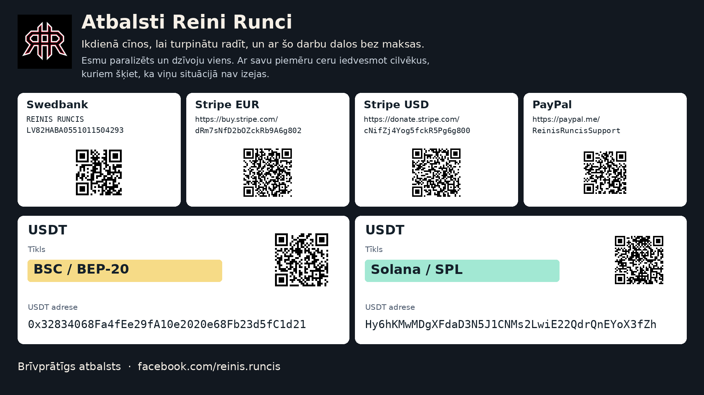

# REYRUN Recursive Deep Search

本公开研究版本保留完整答案、计算和已报告的结果。内部执行记录、原始评审材料及工具查询转储不在本版本中。详见[发布范围](PUBLICATION_SCOPE.md)和[公开结果](PUBLISHED_FINDINGS.md)。

[English](README.md) · [Latviešu](README.lv.md)

这是一项会把经验带入下一次检索、并检验自身流程修改的研究技能。它帮助研究日常与专业问题、核对计算、选择可用软件，并评估能解决未满足需求的组件组合。实际检索由你现有的 AI 智能体完成；持久学习需要把附带的任务循环接入运行环境。具备联网能力时，智能体按英语、德语、中文和日语的检索规则工作，再用你的语言回答。只有在你明确要求时，才增加其他检索语言。

它适合技术选型、陌生机制研究、复杂集成，也适合寻找藏在旧项目名称、小型代码仓库或研究者个人网站中的代码。

## 视频与分享材料

[英语视频](media/reyrun-rekursive-deep-search-demo-en.mp4) · [拉脱维亚语视频](media/reyrun-rekursive-deep-search-demo-lv.mp4) · [字幕与录制说明](media/README.md)。

两段视频均为 65 秒，无音频。它们是剪辑后的说明视频，包含 Duck.ai 中 Claude Haiku 5.5 的真实回答，展示在一次浏览器对话中使用研究指令。视频不代表自动安装技能或启用持久记忆。

[30 个研究示例（拉脱维亚语）](validation/2026-11-09-beta3/30-examples.lv.md) · [英语 Facebook 文案](promo/Facebook_REYRUN_EN.md) · [拉脱维亚语 Facebook 文案](promo/Facebook_REYRUN_LV.md)。[公开下载页面](https://reyrun-rekursive-deep-search.runcisreinis.chatgpt.site)。[发布状态](promo/README.md)。

## 30 个实际研究示例

[修订后的 10 + 10 + 10 选集](validation/2026-11-09-beta3/30-examples.lv.md)包括 10 个日常问题、10 个不同领域的中等难度问题和 10 个复杂问题。其中七个包含完整的高等数学证明或推导，以及实际执行的计算。保留原来的 12 例，补充 18 例；选集中共执行 156 次查询，每例均检索 EN/DE/ZH/JA。查询语言不等于已在该语言中读到支持结论的来源。

[原始 30 例](validation/2026-11-09/30-examples.lv.md)保持不变；加上补充内容，共有 48 个不同的主要研究任务。测试问题及模拟澄清均明确标注。证据索引保留来源、主张、经验使用和文件哈希。公开版本不转载第三方页面全文。

此处提及的内部记录未纳入本版本；详见[发布范围](PUBLICATION_SCOPE.md)。

82 项程序测试记录对应已记录的代码版本。修复了旧卡片遮蔽较新失败观察，以及接近内存上限时孤立证据对象阻止压缩恢复的两个可复现问题。程序机制测试与实际研究质量分开报告。

此处提及的内部记录未纳入本版本；详见[发布范围](PUBLICATION_SCOPE.md)。

另有三个新任务、两组独立执行者的固定预算对比。候选方案、评价条件和正确答案在执行前固定；实际结果、限制及四个独立评审的结论见[发布报告](validation/2026-11-09-beta3/release-report.lv.md)。没有达到预定增益时保留原流程；这一小规模试验不证明普遍优越性。

选集的开始／完成步骤由聊天手动编排。新增的 14 个中等难度及数学案例另行通过严格记录检查。此前的两任务严格宿主演示展示真实研究及下一任务载入经验；它们都不等于无人值守服务。[紧凑观察记录](references/observed-lessons.md)为后续研究保留经验，不替代实际安装的运行时记忆。

此处提及的内部记录未纳入本版本；详见[发布范围](PUBLICATION_SCOPE.md)。

## 三种不同的问题

本技能按问题和用户需要调整研究深度与回答形式。查看已实际检索的拉脱维亚语示例：[表述不清的化妆品问题](examples/cosmetics.md)、[理解游戏作弊技术](examples/gaming.md)、[智能体记忆架构方案](examples/architecture.md)。查询与来源记录区分已阅读证据、未运行项目和拟议实验。这些是真实研究示例，并非优越性的 A/B 证明。

此处提及的内部记录未纳入本版本；详见[发布范围](PUBLICATION_SCOPE.md)。

## 可核查的事实与明确的问题

本技能要求先检索当前外部证据。模型训练时获得的知识可帮助理解主题，但不能代替核查。每项可核查的陈述都必须能够追溯到来源，重要陈述还应在正文附近附上引用。优先寻找专业人员的实际使用报告、维护讨论、失败经验和相关交流，并区分个人意见、观察结果与待检验的假设。

如果设备、目标或使用条件不明确，且会改变建议，智能体必须先提出简短的澄清问题。如果任务本身清楚，只是不知道答案，就应自行查证。信息是否需要更新取决于具体陈述；最新广告不能推翻仍然成立的数学结论。

每份实质性回答都要执行随包提供的 Humanizer 编辑流程，再完整核对含义、事实和来源。表达应友好、礼貌、科学准确，并让目标读者能够理解。详见[证据规则](references/evidence-first-contract.md)与[写作流程](references/writing-contract.md)。

### 如果你的 AI 跳过了必需步骤

可以把这段话交给它：

> 重新阅读 REYRUN REKURSIVE DEEP SEARCH 的强制证据与写作规则。指出具体跳过了哪一步。必要时先澄清任务，再用当前来源核查缺乏依据的陈述并修正相关段落。简要说明依据、提供来源，并明确哪些内容仍未核实。还要检查本次任务的经验是否真的保存，以及下次任务是否载入了它。

在可执行环境中，应通过完成检查落实要求。宿主封装器默认拒绝缺少检索、来源、陈述、编辑或学习记录的结果。记录完整不等于陈述为真，仍需根据读到的来源检查支持关系。相应运行模式需要联网、持久存储与执行能力；更强硬的提示语不会增加这些工具。

## 紧凑的经验库

每张存储的方法卡片最多 1500 个 Unicode 字符，包括字段和来源信息。卡片记录触发条件、适用环境、方法、成功／失败／不确定结果、下一项测试和证据。同一范围内规范化后完全相同的记录会合并；不会仅因用词相似而删除不同的失败经验。已提交的运行状态及证据对象合计不超过 5 MiB；外部任务日志和下载内容需另设保留上限。

每次完成任务都必须记录有证据支持的学习决定。改进研究继续使用本技能的四语言方法；计划与实际检索凭据分开保存。若缺少学习字段，已配置的诊断执行器可在原截止时间内尝试修复一次。未完成学习步骤的结果不会被标为完成。自动生成候选方案和独立评估仍需接入控制器。

[紧凑记忆协议](references/compact-memory-contract.md)说明显式压缩规则。压缩可能有意删除完整旧证据，仅保留卡片及来源哈希，因此不是无损归档。

## 从一个任务开始

把仓库链接或完整下载的文件夹交给智能体，然后输入：

> 阅读这个仓库和 SKILL.md。如果你的环境支持技能，请安装并启用 REYRUN REKURSIVE DEEP SEARCH。把它的持久化开始／完成流程接入现有智能体运行环境，并验证第二次任务确实载入第一次的经验。若已有共用记忆服务，请沿用它。如果环境无法做到，请说明实际启用了哪些部分，并在本次任务中采用研究流程。用英语、德语、中文和日语研究［主题］。比较现成方案；只有在能够说明优势时，才提出组件组合方案。

将 `［主题］` 换成你的目标，并提供输入、期望输出、可用硬件、预算及必须满足的条件。例如：“利用现有智能体运行环境改进 Markdown 技能，不改变模型权重。”

安装位置由宿主环境决定。请把整个文件夹及其引用文件放到宿主文档明确支持的位置。技能标识符为 `reyrun-rekursive-deep-search`。

如果环境不支持安装技能，智能体仍可在当前任务中遵循 [SKILL.md](SKILL.md)。读到仓库链接并不表示已经完成安装、启用持久记忆或接入执行流程。智能体应说明它验证了哪种模式：

| 模式 | 已启用的能力 |
|---|---|
| 研究流程 | 智能体在当前任务中遵循指令。 |
| 持久化递归改进循环 | 宿主执行每次任务的开始和完成步骤，保留证据，并在下次任务中载入经验。 |
| 经过评估的修订版 | 某项流程修改通过了有记录的固定测试任务比较，并被接受为当前版本。 |

## 两次检索之间会发生什么

任务开始时，程序向智能体提供当前流程版本、已接受的策略和来自同一任务范围或共用范围的历史观察。智能体记录自己采用了哪些经验，以及其他经验为何不适用于当前任务。在证据足以支持更强结论之前，观察记录仍保留“未经验证”的状态。

任务结束后，程序保存结果、证据引用、成本、失败及有用发现。智能体可以提出修改检索流程。例如，搜索摘要仍声称“代码尚未发布”时，检查仓库当前的文件。候选流程与当前版本在相同预算下比较。测试条件与正确答案在试验开始前固定，并由四种评审视角检查证据。

只有通过评估并被接受的修改，才会成为下一次任务的当前版本。被拒绝的候选方案保留失败证据；回退到旧版本也不会抹去历史。下一次启动记录会标明实际载入的版本。

智能体必须回顾每个已完成任务，寻找有用经验。这不能保证每次检索都比上一次准确。任务不同，资料会更新，设想中的改进也可能失败。如果没有得到有依据的新经验，程序应如实记录，而不编造进步。

## 你会得到什么

| 结果类别 | 内容 |
|---|---|
| 现成方案 | 多个相关选项，各自的优点、缺点、许可证、资源需求，以及判断其可用程度的证据。 |
| 未完成项目与组合方案 | 可复用的具体组件、缺失工作，以及相对某个现成方案有合理优势依据的组合建议。 |

每条建议都区分已阅读的资料、已检查的代码和实际运行过的方案。组合建议必须说明比较对象、预期收益和可推翻假设的小规模测试，并给出工作量、日历时间、计算量、能源、费用及维护需求的估算和前提。如果证据不足以支持开发，结果会明确说明。

回答提供筛选后的发现、取舍依据和下一步行动。查询日志与学习历史保留在后台，需要时可以索取。可理解性也是评估标准：回答应帮助你做出决定，并保留必要的证据和不确定性。字数更少不等于更好。

## 如何检索

智能体会按各语言的实际用法调整术语，围绕所需功能、失败原因或工作机制继续搜索。它会检查原始资料、项目文件、派生仓库（fork）和问题讨论，也会查看作者网站、机构档案及可下载的补充材料。术语表会区分同义词、上位概念和跨领域类比。

研究接受四种视角的评审：乐观、怀疑、保守和创新。环境支持时，由不同智能体独立形成初步意见；否则，结果会说明这是一个智能体从四种视角进行的审查。查询数量和评审意见一致，都不能单独证明结果正确。接受新修订版需要独立评审记录；单个智能体从四种视角审查，不能替代这一要求。

## 执行与证据

[运行接口说明](references/runtime-contract.md)列出了命令和记录格式。[改进规则](references/evolution-contract.md)说明可以修改什么，以及需要哪些证据。

可执行的[宿主封装器](references/host-contract.md)会在已配置的工作进程前后执行开始和结束步骤，传入已保存的上下文，设置期限，并拒绝未绑定正确开始记录的结果。此约束适用于通过封装器运行的任务。自动提出候选策略和协调独立评估仍需配置控制器；安装技能本身不会启动持续自我改进服务。

```sh
python scripts/search_host.py --help
python scripts/recursive_search.py --help
python scripts/research_gate.py --help
```

`recursive_search.py` 保存任务记录和流程版本，生成下次任务的输入材料，并在接受新版本前检查已记录的测试任务。它不包含模型调用器、网络搜索服务或后台调度器。宿主需要调用它、执行研究，并让候选流程无法改写评估者的文件。程序记录本身不能证明宿主确实落实了这种隔离。

`research_gate.py` 检查研究记录的结构及其声明的条件。两项程序都不会将检查通过视为普遍的质量提升证明。输出保留 `improvement_proven: false`；任何改进结论都必须说明实际试验、结果及适用范围。标注为合成数据的测试验证的是程序行为，不是研究效果。

安装技能不会训练模型权重。持续改进来自保存的经验、修订的指令和经过测试的流程变化。长时间自主运行需要实际的执行进程或调度器、截止时间和资源限额。模型与搜索服务的费用取决于你的环境。

资料核查示例可参见[真实研究结果](examples/real-result.md)，其中保留公开项目和来源链接。原始来源清单与查询转储未纳入本版本。该示例中的外部候选项目未在我们的环境中实际运行。

## 研究报告与默认工作流程

[研究与实验报告](EXPERIMENTS.md)保留最终 30 例、历史 30 例及六份策略比较研究答案的完整内容，并提供计算和作者的发布结论。完整答案有英语与拉脱维亚语版本。候选方案未被采用的结果、失败和限制仍有说明。原始评审材料、内部执行记录、查询转储及内部核验记录不在本版本中；详见[发布范围](PUBLICATION_SCOPE.md)。

安装后，将此方法设为相关研究任务的默认流程，并连接[可执行宿主](references/host-contract.md)，以免每次都要提醒保存经验。宿主会加载已有经验，并拒绝没有有效学习记录的任务完成结果。它需要持久保存的状态目录和已配置的研究执行程序。连接后应连续执行两个任务，确认第二个任务加载了第一个任务的经验。仅阅读说明文件不会自动建立这种连接。

## 支持作者

我叫 Reinis Runcis。我身体瘫痪，独自生活。每天，我都努力坚持创作，并免费分享这份成果。我希望自己的行动也能鼓励那些觉得眼前的困境没有出路的人。

如果这个项目对你有帮助，或者你愿意支持我继续做下去，我会很感激你的自愿捐助。你的支持能帮助我的日常生活，也能让我继续开发这样的工具。

Swedbank · 收款人: **REINIS RUNCIS**  
IBAN: **`LV82HABA0551011504293`**

- [Stripe (EUR)](https://buy.stripe.com/dRm7sNfD2bOZckRb9A6g802)
- [Stripe (USD)](https://donate.stripe.com/cNifZj4Yog5fckR5Pg6g800)
- [PayPal](https://paypal.me/ReinisRuncisSupport)

**USDT · BSC / BEP-20**

`0x32834068Fa4fEe29fA10e2020e68Fb23d5fC1d21`

**USDT · Solana / SPL**

`Hy6hKMwMDgXFdaD3N5J1CNMs2LwiE22QdrQnEYoX3fZh`

[在 Facebook 了解更多关于我的信息](https://www.facebook.com/reinis.runcis)

[Atbalsta lapa / Support page](SUPPORT.md)



## 许可证

原创文本和代码采用 [MIT 许可证](LICENSE)。`assets/support-card.png` 是经作者同意发布的支持图片，不属于 MIT 授权范围。支持信息及标志可以随本项目展示，但不因此授予对品牌或个人故事的其他权利。外部项目仍适用各自的许可证。
