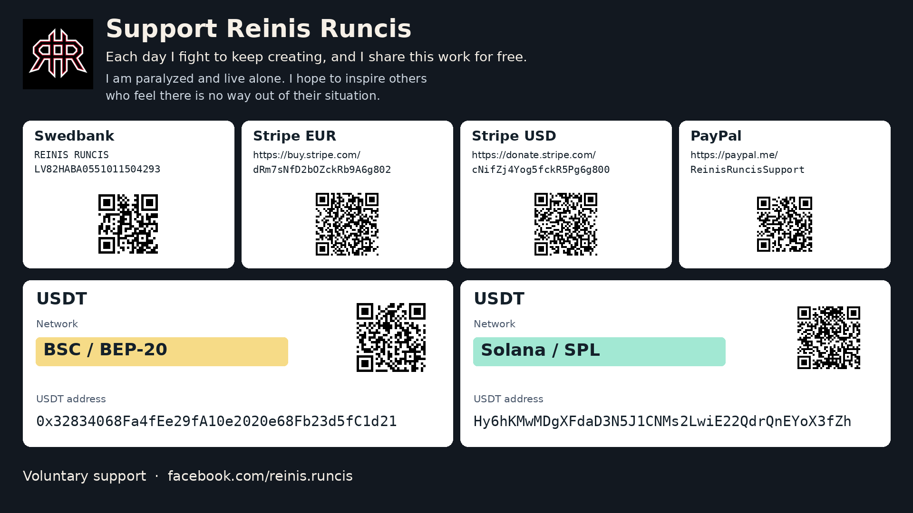

# Support Reinis

My name is Reinis Runcis. I am paralyzed and live alone. Each day I fight to keep creating, and I share this work for free. Through my example, I hope to inspire others who feel there is no way out of their situation.

If this project is useful to you, or you would like to help me carry on, I would be grateful for a voluntary donation. Your support helps me in daily life and in my work on tools like this.

Swedbank · Recipient: **REINIS RUNCIS**  
IBAN: **`LV82HABA0551011504293`**

- [Stripe (EUR)](https://buy.stripe.com/dRm7sNfD2bOZckRb9A6g802)
- [Stripe (USD)](https://donate.stripe.com/cNifZj4Yog5fckR5Pg6g800)
- [PayPal](https://paypal.me/ReinisRuncisSupport)

**USDT · BSC / BEP-20**

`0x32834068Fa4fEe29fA10e2020e68Fb23d5fC1d21`

**USDT · Solana / SPL**

`Hy6hKMwMDgXFdaD3N5J1CNMs2LwiE22QdrQnEYoX3fZh`

[More about me on Facebook](https://www.facebook.com/reinis.runcis)

## Support card

Details and network labels were supplied by the author on November 10, 2026. Each USDT address has its own network label. The QR codes contain the listed addresses or payment links; scanning one does not itself select a cryptocurrency network.

[Original multilingual support text](SUPPORT.original-multilingual.md).
