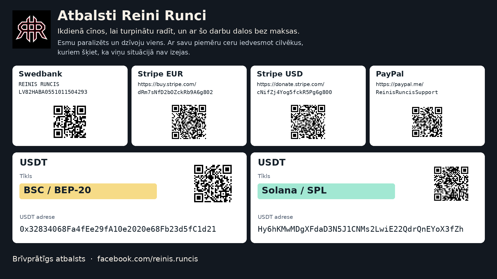

# Atbalsti Reini

Mani sauc Reinis Runcis. Esmu paralizēts un dzīvoju viens. Ikdienā cīnos, lai turpinātu radīt, un ar šo darbu dalos bez maksas. Ceru ar savu piemēru iedvesmot arī cilvēkus, kuriem šķiet, ka viņu situācijā nav izejas.

Ja šis projekts tev noder vai vēlies palīdzēt man turpināt iesākto, būšu pateicīgs par brīvprātīgu ziedojumu. Tavs atbalsts palīdz man ikdienā un darbā pie šādiem rīkiem.

Swedbank · Saņēmējs: **REINIS RUNCIS**  
IBAN: **`LV82HABA0551011504293`**

- [Stripe (EUR)](https://buy.stripe.com/dRm7sNfD2bOZckRb9A6g802)
- [Stripe (USD)](https://donate.stripe.com/cNifZj4Yog5fckR5Pg6g800)
- [PayPal](https://paypal.me/ReinisRuncisSupport)

**USDT · BSC / BEP-20**

`0x32834068Fa4fEe29fA10e2020e68Fb23d5fC1d21`

**USDT · Solana / SPL**

`Hy6hKMwMDgXFdaD3N5J1CNMs2LwiE22QdrQnEYoX3fZh`

[Vairāk par mani Facebook](https://www.facebook.com/reinis.runcis)

## Support Reinis

My name is Reinis Runcis. I am paralyzed and live alone. Each day I fight to keep creating, and I share this work for free. Through my example, I hope to inspire others who feel there is no way out of their situation.

If this project is useful to you, or you would like to help me carry on, I would be grateful for a voluntary donation. Your support helps me in daily life and in my work on tools like this.

Swedbank · Recipient: **REINIS RUNCIS**  
IBAN: **`LV82HABA0551011504293`**

- [Stripe (EUR)](https://buy.stripe.com/dRm7sNfD2bOZckRb9A6g802)
- [Stripe (USD)](https://donate.stripe.com/cNifZj4Yog5fckR5Pg6g800)
- [PayPal](https://paypal.me/ReinisRuncisSupport)

**USDT · BSC / BEP-20**

`0x32834068Fa4fEe29fA10e2020e68Fb23d5fC1d21`

**USDT · Solana / SPL**

`Hy6hKMwMDgXFdaD3N5J1CNMs2LwiE22QdrQnEYoX3fZh`

[More about me on Facebook](https://www.facebook.com/reinis.runcis)

## 支持 Reinis

我叫 Reinis Runcis。我身体瘫痪，独自生活。每天，我都努力坚持创作，并免费分享这份成果。我希望自己的行动也能鼓励那些觉得眼前的困境没有出路的人。

如果这个项目对你有帮助，或者你愿意支持我继续做下去，我会很感激你的自愿捐助。你的支持能帮助我的日常生活，也能让我继续开发这样的工具。

Swedbank · 收款人: **REINIS RUNCIS**  
IBAN: **`LV82HABA0551011504293`**

- [Stripe (EUR)](https://buy.stripe.com/dRm7sNfD2bOZckRb9A6g802)
- [Stripe (USD)](https://donate.stripe.com/cNifZj4Yog5fckR5Pg6g800)
- [PayPal](https://paypal.me/ReinisRuncisSupport)

**USDT · BSC / BEP-20**

`0x32834068Fa4fEe29fA10e2020e68Fb23d5fC1d21`

**USDT · Solana / SPL**

`Hy6hKMwMDgXFdaD3N5J1CNMs2LwiE22QdrQnEYoX3fZh`

[在 Facebook 了解更多关于我的信息](https://www.facebook.com/reinis.runcis)

## Atbalsta kartīte / Support card

Rekvizīti un tīklu nosaukumi ir autora norādīti 2026. gada 10. novembrī. Katras USDT adreses tīkls ir norādīts atsevišķi. QR kodi satur norādītās adreses vai maksājumu saites; to nolasīšana pati neizvēlas kriptovalūtas tīklu.

Details and network labels were supplied by the author on 10 November 2026. Each USDT address has its own network label. The QR codes contain the listed addresses or payment links; scanning one does not itself select a cryptocurrency network.
